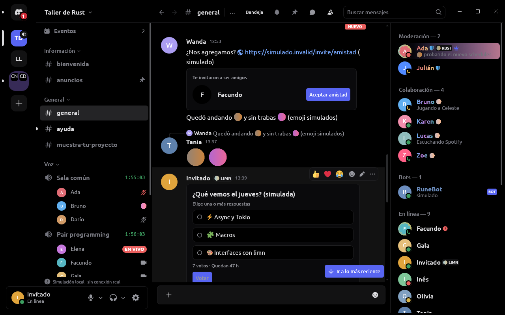
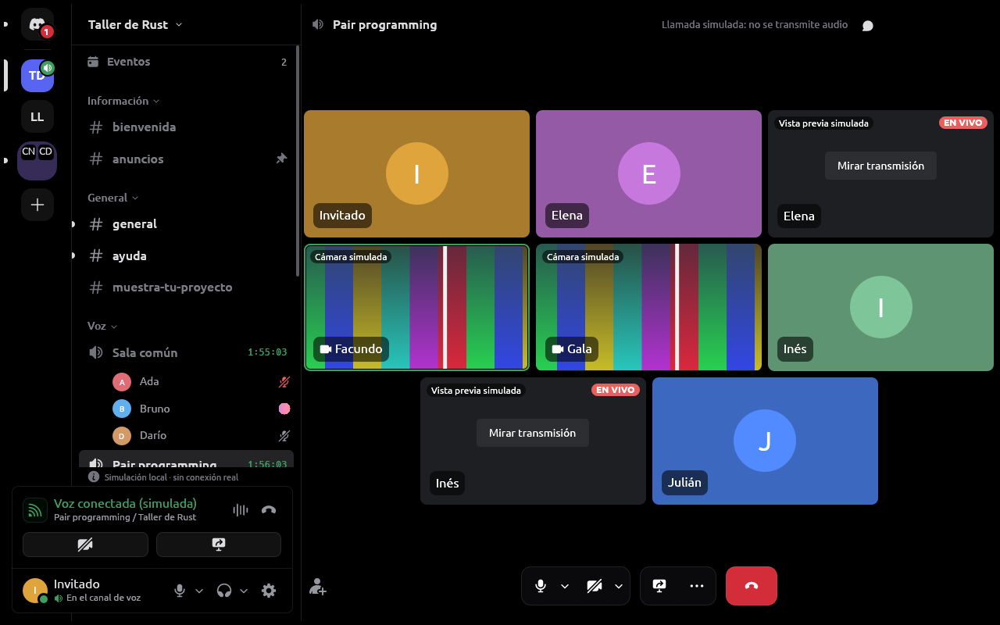
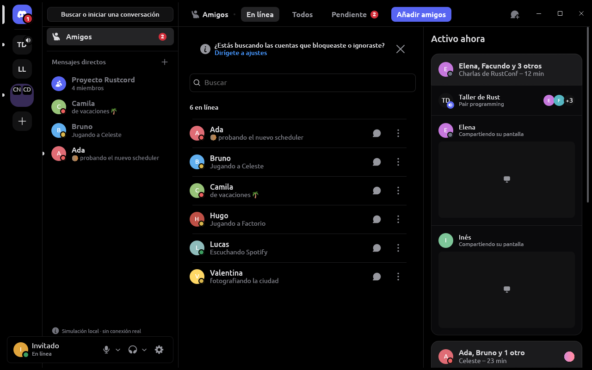

<div align="center">

[English](README.md) · **Español**


# Rustcord

**Cliente de chat de escritorio nativo, escrito en Rust y dibujado con
[limn](https://github.com/Niiihuel/limn). Sin Electron.**

[](https://github.com/Niiihuel/rustcord/releases/latest)
[](https://github.com/Niiihuel/rustcord/actions/workflows/ci.yml)
[](#licencia)
[](rust-toolchain.toml)
[](#descarga-e-instalación)
[](https://github.com/sponsors/Niiihuel)

[Descargar](https://github.com/Niiihuel/rustcord/releases/latest) ·
[Capturas](#capturas) ·
[Rendimiento](#rendimiento-frente-a-discord) ·
[Compilar](#compilar-desde-el-código)

</div>

> [!WARNING]
> **Rustcord es un proyecto independiente y personal. No está afiliado a
> Discord, ni respaldado ni aprobado por Discord.**
>
> Su proveedor no oficial (`rustcord-discord-session`) habla con Discord como
> lo haría el cliente web de Discord en un navegador. Eso puede infringir los
> Términos de Servicio de Discord y poner en riesgo tu cuenta, y puede dejar de
> funcionar en cualquier momento. Que el dueño de Rustcord haya autorizado este
> experimento personal no implica que Discord lo apruebe. **Úsalo bajo tu
> propia responsabilidad.** Qué hace y qué no hace, en
> [Proveedores](#proveedores) y [Privacidad y seguridad](#privacidad-y-seguridad).
> Rustcord también lo advierte en **Ajustes → Conexiones**.

## Contenido

- [Qué es](#qué-es)
- [Capturas](#capturas)
- [Funciones](#funciones)
- [Rendimiento frente a Discord](#rendimiento-frente-a-discord)
- [Descarga e instalación](#descarga-e-instalación)
- [Compilar desde el código](#compilar-desde-el-código)
- [Proveedores](#proveedores)
- [Privacidad y seguridad](#privacidad-y-seguridad)
- [Contribuir](#contribuir)
- [Licencia](#licencia)
- [Apoyar el proyecto](#apoyar-el-proyecto)

## Qué es

Rustcord es un cliente de chat de escritorio con el aspecto del Discord
actual, hecho como un programa nativo: un solo ejecutable en Rust cuya
interfaz entera dibuja [limn](https://github.com/Niiihuel/limn) sobre la GPU
(wgpu). No hay Electron, ni navegador, ni JavaScript en la interfaz: eframe
sólo abre la ventana. La única excepción es una WebView aislada y temporal
para iniciar sesión con el proveedor no oficial y para el hCaptcha que Discord
pueda pedir, nunca para las conversaciones.

La arquitectura no depende del servicio: todo lo que está por encima de
`rustcord-provider` habla con un *proveedor* y no conoce a Discord. Hay tres:
uno simulado, uno oficial (OAuth2) y uno no oficial
(ver [Proveedores](#proveedores)).

## Capturas

<p align="center">
  
</p>
<p align="center">
  
  
</p>

<sub>Capturas de Rustcord 0.2.0 a 1280×800 con el proveedor simulado
(`--provider mock`): nombres, mensajes, cámaras y transmisiones son de
ejemplo, no de personas reales.</sub>

## Funciones

- 💬 **Chat**: servidores, canales, hilos, mensajes directos y grupos;
  Markdown con código resaltado, respuestas, reacciones, menciones, mensajes
  fijados, encuestas, búsqueda, bandeja de entrada e invitaciones; adjuntos
  arrastrados o pegados (con su miniatura), GIF, emoji, stickers, mensajes de
  voz y un visor de imágenes y videos.
- 🎙️ **Voz y video**: salas de voz y escenarios, llamadas privadas, cámara,
  compartir pantalla y mirar transmisiones, *picture-in-picture*; supresión de
  ruido (RNNoise, DeepFilterNet o WebRTC) y cancelación de eco; pulsar para
  hablar también fuera de la ventana; las llamadas del proveedor no oficial
  usan DAVE, el cifrado de extremo a extremo de Discord.
- 👥 **Personas**: amigos y solicitudes, «Activo ahora», perfiles con
  insignias, «Colección de juegos» y «Lista de deseados», el panel de perfil en
  los mensajes directos, cuentas bloqueadas e ignoradas, y varias cuentas
  recordadas.
- 🤖 **Apps y bots**: botones, menús y formularios de los bots, y comandos de
  aplicación (proveedor no oficial). Rustcord no administra bots.
- 🎨 **Aspecto**: el tema «Midnight» de Discord con su *blurple* como acento,
  sus iconos animados y sus medidas; temas propios (colores, color principal y
  transparencia de la ventana), barra de título propia o del sistema, la
  fuente de la interfaz a elección (Mada por defecto), y la interfaz en
  español o en inglés.
- 🖥️ **Escritorio**: icono en la bandeja, inicio con la sesión,
  notificaciones, una sola instancia que recibe los enlaces, y en Windows el
  botón de la barra de tareas que muestra la llamada. *Rich Presence* local
  (`discord-ipc`) y detección de juegos, apagadas por defecto.
- ⚙️ **Por dentro**: caché local cifrada por cuenta (Rustcord abre con lo que
  ya tenía mientras se conecta) y actualizaciones con un manifiesto firmado
  con Ed25519.

Las novedades de cada versión están en sus
[notas de release](https://github.com/Niiihuel/rustcord/releases).

## Rendimiento frente a Discord

Medido el **2026-11-04** en la misma máquina, con las dos aplicaciones abiertas
a la vez. Sólo cifras medidas; el método, los datos crudos y los comandos
exactos están en [docs/benchmarks.md](docs/benchmarks.md).

| | Discord 1.0.168 | Rustcord 0.2.0 |
| --- | ---: | ---: |
| Memoria (PSS, suma de sus procesos) | 576,6 MiB | 121,9 MiB |
| Procesos / hilos | 10 / 177 | 1 / 24 |
| CPU media en 60 s (% de un hilo) | 31,9 % | 1,0 % |
| En disco | 557,0 MiB + 6,8 MiB del paquete | 121,5 MiB |
| Descarga | no medida | 51,5 MiB (`rustcord-x86_64-linux.gz`) |
| Arranque hasta el primer fotograma | no medido | 94,9 ms (mediana de 5) |

```text
Memoria (PSS)  Discord   ██████████████████████████████  576,6 MiB
               Rustcord  ██████▍                         121,9 MiB
CPU media      Discord   ██████████████████████████████  31,9 %
               Rustcord  █                               1,0 %
En disco       Discord   ██████████████████████████████  563,8 MiB
               Rustcord  ██████▌                         121,5 MiB
```

**Condiciones, que importan:**

- **Máquina**: AMD Ryzen 9 270 (8 núcleos, 16 hilos), 15 265 MiB de RAM,
  CachyOS con Linux 7.3.1, niri 26.04 (Wayland).
- **Discord** era la sesión real de su dueño, con su cuenta y sus servidores,
  abierta desde hacía casi dos horas y con la ventana enfocada en una
  pantalla de 2880×1800 a 120 Hz. Sólo se leyó `/proc`; no se lo tocó.
- **Rustcord** usó el **proveedor simulado**, con datos de ejemplo y su
  actividad simulada encendida (mensajes, presencias, contadores), en una
  pantalla X oculta y recién abierto. Es la build de release local del tag
  `v0.2.0`, sin la feature `session-login`, así que no usó la cuenta.
- **No es la misma carga**: tómalo como orden de magnitud en esta máquina, no
  como una comparación exacta.
- **Memoria como PSS** porque RSS cuenta entera cada página compartida en cada
  proceso que la mapea, y los procesos de Electron comparten muchas: sumar su
  RSS las contaría varias veces (sumado, daría 752,1 MiB para Discord y
  161,9 MiB para Rustcord).
- Tres rondas de 60 s, con muestras cada 10 s; se da la mediana. La CPU es el
  porcentaje de **un** hilo. El arranque de Discord no se midió, porque habría
  que reiniciar el Discord de su dueño. «En disco» no cuenta datos de
  usuario.

## Descarga e instalación

Las versiones se publican en
[GitHub Releases](https://github.com/Niiihuel/rustcord/releases/latest); la
actual es la 0.2.3. Cada una lleva el programa para Linux
(`rustcord-x86_64-linux.gz`), el instalador de Windows
(`rustcord-x86_64-windows-setup.exe`) cuando su compilación está activada (la
0.1.1, por ejemplo, salió sólo para Linux), y el manifiesto que lee el
actualizador de Rustcord (`rustcord-update.json`), firmado con Ed25519
(`rustcord-update.json.sig`). No hay versión para macOS.

### Linux (x86_64)

`rustcord-x86_64-linux.gz` es el programa entero comprimido. Se compila en
Ubuntu 24.04, así que pide glibc 2.39 o más nueva, y usa bibliotecas del
sistema: GStreamer, PipeWire, ALSA, Wayland/xkbcommon y, para el inicio de
sesión no oficial, GTK 4 y WebKitGTK 6.0.

```sh
gunzip rustcord-x86_64-linux.gz
chmod +x rustcord-x86_64-linux
./rustcord-x86_64-linux --install
```

`--install` lo instala para tu usuario, sin permisos de administrador: el
programa en `~/.local/share/rustcord/app`, un lanzador en
`~/.local/bin/rustcord`, una entrada en el menú de aplicaciones y su icono.
Así instalado, Rustcord busca actualizaciones al abrir (se puede apagar en
Ajustes) y verifica su firma antes de instalarlas. También se puede ejecutar
sin instalar, pero entonces no se actualiza solo.

### Windows (x86_64)

`rustcord-x86_64-windows-setup.exe` es un instalador por usuario, sin
permisos de administrador, para Windows 10 o más nuevo. Instala en
`%LOCALAPPDATA%\Programs\Rustcord`; tus datos quedan en
`%LOCALAPPDATA%\Rustcord` y `%APPDATA%\Rustcord`, y ni las actualizaciones ni
la desinstalación los tocan. El inicio de sesión no oficial usa el WebView2
Runtime de Windows.

### Avisos de licencias

Cada versión lleva sus avisos de terceros: `rustcord --licenses` los imprime, y
la release también publica `THIRD_PARTY_NOTICES.md` y
`rustcord-licenses.tar.gz`.

## Compilar desde el código

Rustup instala solo el compilador que fija
[`rust-toolchain.toml`](rust-toolchain.toml) (Rust 1.99.1, con rustfmt y
clippy).

La compilación usa bibliotecas del sistema. En **Ubuntu 24.04 o Debian**, los
mismos paquetes que instala la [release](.github/workflows/release.yml), más
D-Bus y los plugins de GStreamer para correr los tests y reproducir videos:

```sh
sudo apt-get install build-essential cmake nasm clang libclang-dev pkg-config \
  libasound2-dev libpipewire-0.3-dev libspa-0.2-dev \
  libwayland-dev libxkbcommon-dev \
  libgstreamer1.0-dev libgstreamer-plugins-base1.0-dev \
  libgtk-4-dev libwebkitgtk-6.0-dev \
  dbus gstreamer1.0-plugins-base gstreamer1.0-plugins-good gstreamer1.0-plugins-bad
```

En **Arch Linux o CachyOS**, los paquetes equivalentes:

```sh
sudo pacman -S --needed base-devel cmake nasm clang pkgconf \
  alsa-lib pipewire wayland libxkbcommon \
  gstreamer gst-plugins-base gst-plugins-good gst-plugins-bad \
  gtk4 webkitgtk-6.0 dbus
```

GTK 4 y WebKitGTK 6 (`libgtk-4-dev libwebkitgtk-6.0-dev`, o `gtk4
webkitgtk-6.0`) sólo hacen falta para `session-login`. Después:

```sh
git clone https://github.com/Niiihuel/rustcord
cd rustcord
cargo run -p rustcord-desktop      # la ventana
```

**El proveedor no oficial** se compila sólo con la feature `session-login`
(Linux o Windows); en Linux, con los paquetes de desarrollo de GTK 4 y
WebKitGTK 6 de arriba instalados:

```sh
cargo run -p rustcord-desktop --features session-login
```

**Comprobaciones** (las mismas que la CI):

```sh
cargo fmt --all -- --check
cargo clippy --workspace --all-targets
cargo test --workspace
```

En Windows, con la cadena MSVC de Visual Studio y CMake:
`cargo build --release -p rustcord-desktop --features session-login`.

Algunas opciones útiles al desarrollar:

```sh
cargo run -p rustcord-desktop -- --provider mock                       # datos simulados
cargo run -p rustcord-desktop -- --screenshot shot.png --channel general
cargo run --release -p rustcord-desktop -- --bench                     # medición de scroll
```

## Proveedores

| Proveedor | `--provider` | Qué es |
| --- | --- | --- |
| **Simulado** | `mock` | Datos de ejemplo locales, sin red. La interfaz lo marca como «Simulación local · sin conexión real». Para probar y desarrollar. |
| **Oficial** (OAuth2) | `discord` | Experimental y limitado a la identidad: OAuth2 con los permisos `identify guilds`, sin bot ni token personal; no habilita mensajes ni voz. Pide el ID público de tu aplicación (`--discord-client-id` o `RUSTCORD_DISCORD_CLIENT_ID`) y el redirect `http://127.0.0.1:48731/oauth/callback` registrado en el Developer Portal. |
| **No oficial** (sesión) | `discord-session` | Experimento personal con una cuenta normal: mensajes, voz, video y el resto de las funciones. Habla con Discord como su cliente web en un navegador. Sólo en builds con `session-login`, como las releases. **Lee la advertencia de arriba.** |

Las releases empiezan en el inicio de sesión del proveedor no oficial;
el proveedor se cambia en **Ajustes → Conexiones** (o con `--provider`) y
Rustcord recuerda el último elegido.

Sobre el proveedor no oficial, concretamente:

- Se presenta como el cliente web de Discord en un navegador (*user agent*,
  `X-Super-Properties`, huella y propiedades del *Identify*), con una sola
  identidad coherente en REST, el Gateway y la WebView del hCaptcha.
- Puede usar rutas no documentadas (el perfil completo y la lista de miembros
  por suscripción), los componentes de los bots y los comandos de aplicación.
- **No** evade ni automatiza CAPTCHA ni MFA: los resuelve la persona. Si
  Discord pide un hCaptcha, aparece en una página propia de Rustcord; nunca se
  reenvía a servicios externos, y su respuesta permite un solo reintento de la
  misma acción.
- **No** lee sesiones ni datos locales del cliente oficial de Discord ni de
  navegadores, y no accede a cuentas ajenas.
- El socket local `discord-ipc` (*Rich Presence*) y la detección de juegos
  vienen apagados, cada uno con su interruptor.

## Privacidad y seguridad

- **Credenciales**: el proveedor no oficial tiene su propio inicio de sesión,
  en una ventana aislada y temporal. La credencial queda dentro de Rustcord y
  se guarda **sólo** en el llavero del sistema (Secret Service en Linux, el
  Administrador de credenciales en Windows) para restaurar la sesión al abrir;
  nunca en la base de datos, archivos, registros ni configuración. Al cerrar
  sesión se borra del llavero.
- **Caché cifrada por cuenta**: mensajes, borradores, la instantánea del
  estado y las marcas de lectura se guardan cifrados, con una clave por cuenta
  que vive en el llavero, nunca en disco. Sin llavero, quedan sólo en memoria,
  nunca en texto plano. Al cerrar sesión u olvidar la cuenta se borran sus
  datos y su clave.
- **Pulsar para hablar global**: en Windows, un gancho de teclado y ratón de
  bajo nivel que nunca consume la entrada, sólo compara cada evento con la
  tecla o combinación elegida y no guarda, envía ni registra teclas. Como en
  Discord, sirve cualquier tecla, y un juego abierto como administrador
  sólo deja oírla si Rustcord también lo está.
- **Actualizaciones**: el manifiesto de cada versión va firmado con Ed25519 y
  Rustcord comprueba la firma con la clave que lleva compilada antes de
  instalar nada.
- Rustcord no incluye telemetría ni envío automático de errores. Con el
  proveedor no oficial, lo que hagas llega a Discord como desde su cliente
  web.

## Contribuir

Las reglas del proyecto están en [AGENTS.md](AGENTS.md), que vale para personas
y agentes. En corto:

- Toda la interfaz es limn. Si a limn le falta algo, se implementa en
  [limn](https://github.com/Niiihuel/limn) con su propio PR; no se parchea
  dentro de Rustcord.
- Las capas sólo dependen hacia abajo, la UI es controlada (el estado en
  `Store` y `Ui`) y nada bloqueante corre en el hilo de la interfaz.
- Los textos de la interfaz, en español y en inglés a través de
  `rustcord_i18n`; los comentarios y la documentación del código, en inglés.
- Una dependencia nueva lleva un comentario que diga por qué.
- Nada de código copiado de otros clientes o servicios, y nada se da por
  funcionando sin haberlo probado.
- Antes de un PR: `cargo fmt --all -- --check`, `cargo clippy --workspace
  --all-targets` y `cargo test --workspace`.

## Licencia

El código de Rustcord está bajo **MIT o Apache-2.0**, a tu elección:
[LICENSE-MIT](LICENSE-MIT) y [LICENSE-APACHE](LICENSE-APACHE). Las
dependencias y recursos de terceros, con sus licencias, están en
[THIRD_PARTY_NOTICES.md](THIRD_PARTY_NOTICES.md) y
[assets/licenses](assets/licenses). Entre ellos está la fuente de la
interfaz, **Mada** (SIL Open Font License 1.1), la libre más cercana a la gg
sans de Discord, que Rustcord incluye recortada al latín
([assets/licenses/FONT-NOTICES.md](assets/licenses/FONT-NOTICES.md),
[docs/discord-reference.md](docs/discord-reference.md#typography)).

**Recursos de Discord.** Por decisión del dueño de Rustcord, el proyecto
incluye recursos de Discord: sus efectos de sonido públicos
([assets/sounds/discord](assets/sounds/discord), con su origen), el icono de
la aplicación ([assets/icons/rustcord-discord.png](assets/icons/rustcord-discord.png)),
el logo de Discord como marca de la interfaz
([assets/rustcord-mark.svg](assets/rustcord-mark.svg)) y los iconos de su
interfaz ([assets/glyphs](assets/glyphs)), y reproduce su paleta y las medidas
de su interfaz ([docs/discord-reference.md](docs/discord-reference.md)). Esa
decisión no es una autorización ni un respaldo de Discord: esos recursos y el
nombre y el logo de Discord siguen siendo de Discord y marcas suyas, **no**
están bajo la licencia de Rustcord y no se pueden reutilizar bajo MIT ni
Apache-2.0. Los logos de los servicios de las conexiones
([assets/connections](assets/connections)), tal como el cliente web de Discord
los sirve, son marcas de sus dueños, están sólo para nombrar cada conexión y
tampoco están bajo la licencia de Rustcord.

## Apoyar el proyecto

Si Rustcord te sirve, puedes apoyarlo con
[GitHub Sponsors](https://github.com/sponsors/Niiihuel) 💜. También ayuda
abrir un issue con lo que falle o lo que falte.
