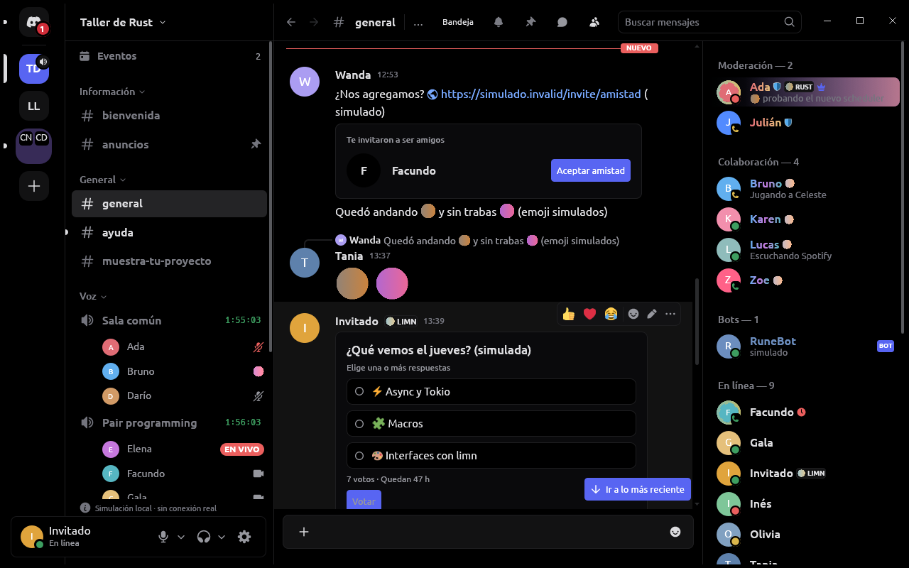
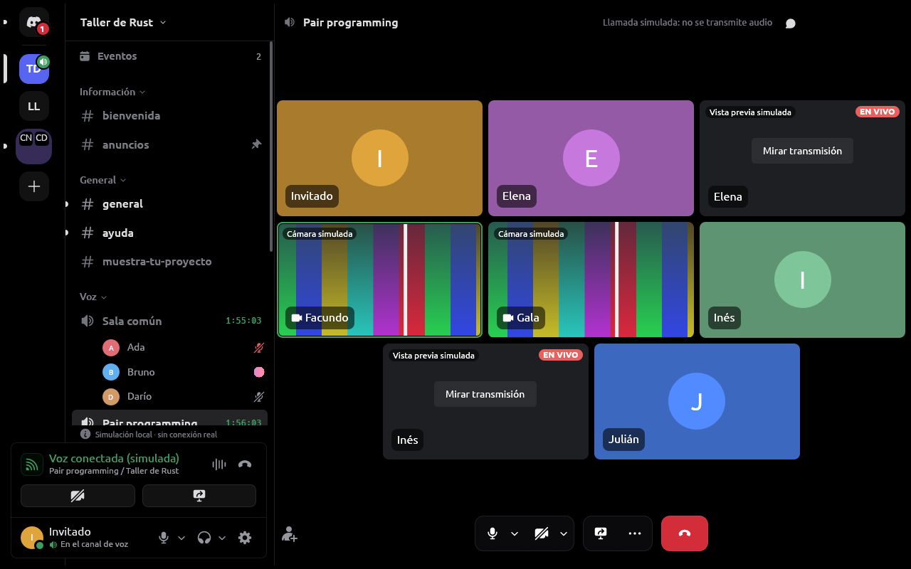
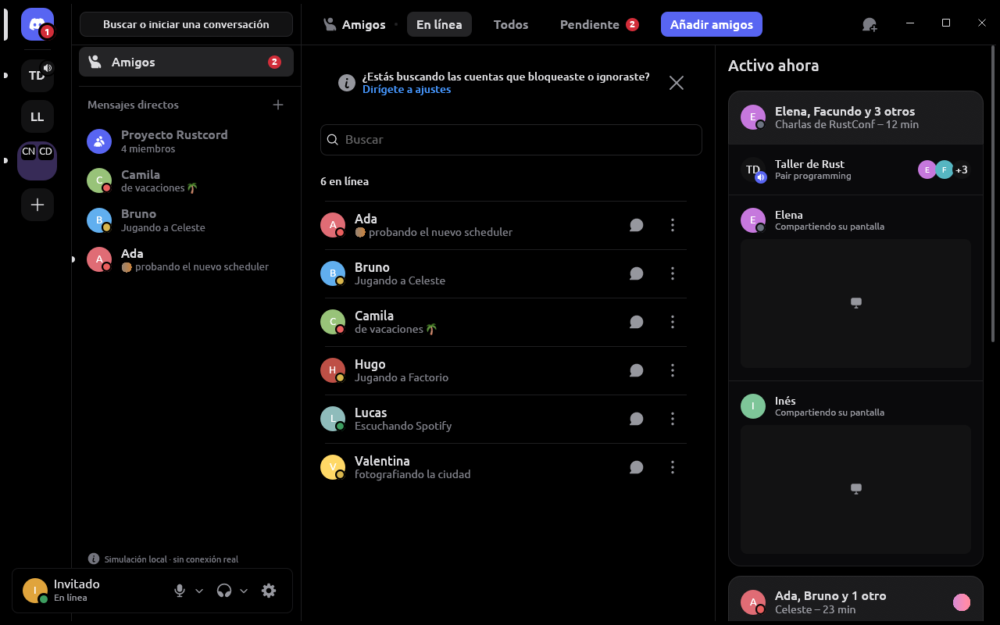

<div align="center">

**English** · [Español](README.es.md)


# Rustcord

**A native desktop chat client, written in Rust and drawn with
[limn](https://github.com/Niiihuel/limn). No Electron.**

[](https://github.com/Niiihuel/rustcord/releases/latest)
[](https://github.com/Niiihuel/rustcord/actions/workflows/ci.yml)
[](#license)
[](rust-toolchain.toml)
[](#download-and-install)
[](https://github.com/sponsors/Niiihuel)

[Download](https://github.com/Niiihuel/rustcord/releases/latest) ·
[Screenshots](#screenshots) ·
[Performance](#performance-compared-with-discord) ·
[Build](#build-from-source)

</div>

> [!WARNING]
> **Rustcord is an independent, personal project. It is not affiliated with
> Discord, nor endorsed or approved by Discord.**
>
> Its unofficial provider (`rustcord-discord-session`) talks to Discord the
> way Discord's web client in a browser would. That may break Discord's Terms
> of Service and put your account at risk, and it may stop working at any
> time. That Rustcord's owner authorized this personal experiment does not
> mean Discord approves of it. **Use it at your own risk.** What it does and
> doesn't do is in [Providers](#providers) and
> [Privacy and security](#privacy-and-security). Rustcord also warns about it
> in **Settings → Connections**.

## Contents

- [What it is](#what-it-is)
- [Screenshots](#screenshots)
- [Features](#features)
- [Performance compared with Discord](#performance-compared-with-discord)
- [Download and install](#download-and-install)
- [Build from source](#build-from-source)
- [Providers](#providers)
- [Privacy and security](#privacy-and-security)
- [Contributing](#contributing)
- [License](#license)
- [Support the project](#support-the-project)

## What it is

Rustcord is a desktop chat client that looks like today's Discord, built as a
native program: a single Rust executable whose whole interface is drawn by
[limn](https://github.com/Niiihuel/limn) on the GPU (wgpu). There is no
Electron, no browser and no JavaScript in the interface: eframe only opens the
window. The one exception is an isolated, temporary WebView for signing in
with the unofficial provider and for the hCaptcha Discord may ask for, never
for conversations.

The architecture does not depend on the service: everything above
`rustcord-provider` talks to a *provider* and knows nothing about Discord.
There are three: a simulated one, an official one (OAuth2) and an unofficial
one (see [Providers](#providers)).

## Screenshots

<p align="center">
  
</p>
<p align="center">
  
  
</p>

<sub>Screenshots of Rustcord 0.2.0 at 1280×800 with the simulated provider
(`--provider mock`): names, messages, cameras and streams are sample data, not
real people.</sub>

## Features

- 💬 **Chat**: servers, channels, threads, direct messages and group DMs;
  Markdown with highlighted code, replies, reactions, mentions, pinned
  messages, polls, search, inbox and invites; attachments dragged or pasted
  in (with their thumbnail), GIFs, emoji, stickers, voice messages, and an
  image and video viewer.
- 🎙️ **Voice and video**: voice and stage channels, private calls, camera,
  screen sharing and watching streams, *picture-in-picture*; noise
  suppression (RNNoise, DeepFilterNet or WebRTC) and echo cancellation;
  push-to-talk outside the window too; the unofficial provider's calls use
  DAVE, Discord's end-to-end encryption.
- 👥 **People**: friends and friend requests, Active Now, profiles with
  badges, Game Collection and Wishlist, the profile panel in direct messages,
  blocked and ignored accounts, and several remembered accounts.
- 🤖 **Apps and bots**: bots' buttons, menus and forms, and application
  commands (unofficial provider). Rustcord is not a bot manager.
- 🎨 **Appearance**: Discord's Midnight theme with its *blurple* as the
  accent, its animated icons and its measurements; custom themes (colors,
  main color and window transparency), Rustcord's own title bar or the
  system's, the interface font of your choice (Mada by default), and the
  interface in Spanish or English.
- 🖥️ **Desktop**: tray icon, start with the session, notifications, a single
  instance that receives links, and on Windows the taskbar button that shows
  the call. Local *Rich Presence* (`discord-ipc`) and game detection, both off
  by default.
- ⚙️ **Under the hood**: an encrypted local cache per account (Rustcord opens
  with what it already had while it connects) and updates with a manifest
  signed with Ed25519.

What's new in each version is in its
[release notes](https://github.com/Niiihuel/rustcord/releases).

## Performance compared with Discord

Measured on the same machine: Discord on **2026-11-04**, Rustcord again on
**2026-11-05** with the same method. Measured figures only; the method, the raw
data and the exact commands are in [docs/benchmarks.md](docs/benchmarks.md).

| | Discord 1.0.168 | Rustcord 0.2.4 |
| --- | ---: | ---: |
| Memory (PSS, sum of its processes) | 576.6 MiB | 90.1 MiB |
| Processes / threads | 10 / 177 | 1 / 17 |
| Mean CPU over 60 s (% of one thread) | 31.9% | 0.8% |
| On disk | 557.0 MiB + 6.8 MiB of the package | 91.6 MiB |
| Download | not measured | 43.0 MiB (`gzip -9` of the local build) |
| Startup to first frame | not measured | 69–75 ms |

```text
Memory (PSS)   Discord   ██████████████████████████████  576.6 MiB
               Rustcord  ████▋                           90.1 MiB
Mean CPU       Discord   ██████████████████████████████  31.9%
               Rustcord  ▊                               0.8%
On disk        Discord   ██████████████████████████████  563.8 MiB
               Rustcord  ████▉                           91.6 MiB
```

**The conditions, which matter:**

- **Machine**: AMD Ryzen 9 270 (8 cores, 16 threads), 15,265 MiB of RAM,
  CachyOS with Linux 7.3.1, niri 26.04 (Wayland).
- **Discord** was its owner's real session, with their account and their
  servers, open for almost two hours and with the window focused on a
  2880×1800 display at 120 Hz. Only `/proc` was read; it was not touched.
- **Rustcord** used the **simulated provider**, with sample data and its
  simulated activity on (messages, presences, counters), on a hidden X
  display and freshly opened. It is the local release build of 0.2.4
  (whole-program LTO, wgpu on Vulkan only), without the `session-login`
  feature, so it did not use the account. Two 60 s rounds; 0.2.0 measured
  121.9 MiB, 24 threads and 1.0% the day before.
- **It is not the same workload**: take it as an order of magnitude on this
  machine, not as an exact comparison.
- **Memory as PSS** because RSS counts every shared page in full in every
  process that maps it, and Electron's processes share many: adding up their
  RSS would count them several times (added up, it would give 752.1 MiB for
  Discord and 161.9 MiB for Rustcord).
- Three 60 s rounds, sampled every 10 s; the median is given. CPU is the
  percentage of **one** thread. Discord's startup was not measured, because
  that would mean restarting its owner's Discord. "On disk" does not count
  user data.

## Download and install

Releases are published on
[GitHub Releases](https://github.com/Niiihuel/rustcord/releases/latest); the
current version is 0.2.4. Each one carries the Linux program
(`rustcord-x86_64-linux.gz`), the Windows installer
(`rustcord-x86_64-windows-setup.exe`) when its build is enabled (0.1.1, for
example, came out for Linux only), and the update manifest that Rustcord's
updater reads (`rustcord-update.json`), signed with Ed25519
(`rustcord-update.json.sig`). There is no macOS version.

### Linux (x86_64)

`rustcord-x86_64-linux.gz` is the whole program, compressed. It is built on
Ubuntu 24.04, so it needs glibc 2.39 or newer, and it uses the system's
libraries: GStreamer, PipeWire, ALSA, Wayland/xkbcommon and, for the
unofficial sign-in, GTK 4 and WebKitGTK 6.0.

```sh
gunzip rustcord-x86_64-linux.gz
chmod +x rustcord-x86_64-linux
./rustcord-x86_64-linux --install
```

`--install` installs it for your user, without administrator rights: the
program in `~/.local/share/rustcord/app`, a launcher in
`~/.local/bin/rustcord`, an entry in the applications menu and its icon.
Installed this way, Rustcord checks for updates when it opens (this can be
turned off in Settings) and verifies their signature before installing them.
It can also run without being installed, but then it does not update itself.

### Windows (x86_64)

`rustcord-x86_64-windows-setup.exe` is a per-user installer, without
administrator rights, for Windows 10 or newer. It installs to
`%LOCALAPPDATA%\Programs\Rustcord`; your data stays in
`%LOCALAPPDATA%\Rustcord` and `%APPDATA%\Rustcord`, and neither updates nor
uninstalling touch it. The unofficial sign-in uses Windows' WebView2 Runtime.

### License notices

Every version carries its third-party notices: `rustcord --licenses` prints
them, and the release also publishes `THIRD_PARTY_NOTICES.md` and
`rustcord-licenses.tar.gz`.

## Build from source

Rustup installs the compiler pinned by
[`rust-toolchain.toml`](rust-toolchain.toml) on its own (Rust 1.99.1, with
rustfmt and clippy).

The build uses the system's libraries. On **Ubuntu 24.04 or Debian**, the same packages the [release](.github/workflows/release.yml)
installs, plus D-Bus and GStreamer's plugins to run the tests and play videos:

```sh
sudo apt-get install build-essential cmake nasm clang libclang-dev pkg-config \
  libasound2-dev libpipewire-0.3-dev libspa-0.2-dev \
  libwayland-dev libxkbcommon-dev \
  libgstreamer1.0-dev libgstreamer-plugins-base1.0-dev \
  libgtk-4-dev libwebkitgtk-6.0-dev \
  dbus gstreamer1.0-plugins-base gstreamer1.0-plugins-good gstreamer1.0-plugins-bad
```

On **Arch Linux or CachyOS**, the equivalent packages:

```sh
sudo pacman -S --needed base-devel cmake nasm clang pkgconf \
  alsa-lib pipewire wayland libxkbcommon \
  gstreamer gst-plugins-base gst-plugins-good gst-plugins-bad \
  gtk4 webkitgtk-6.0 dbus
```

GTK 4 and WebKitGTK 6 (`libgtk-4-dev libwebkitgtk-6.0-dev`, or `gtk4
webkitgtk-6.0`) are only needed for `session-login`. Then:

```sh
git clone https://github.com/Niiihuel/rustcord
cd rustcord
cargo run -p rustcord-desktop      # the window
```

**The unofficial provider** is only built with the `session-login` feature
(Linux or Windows); on Linux, with the GTK 4 and WebKitGTK 6 development
packages above installed:

```sh
cargo run -p rustcord-desktop --features session-login
```

**Checks** (the same as CI):

```sh
cargo fmt --all -- --check
cargo clippy --workspace --all-targets
cargo test --workspace
```

On Windows, with Visual Studio's MSVC toolchain and CMake:
`cargo build --release -p rustcord-desktop --features session-login`.

Some options useful while developing:

```sh
cargo run -p rustcord-desktop -- --provider mock                       # simulated data
cargo run -p rustcord-desktop -- --screenshot shot.png --channel general
cargo run --release -p rustcord-desktop -- --bench                     # scroll benchmark
```

## Providers

| Provider | `--provider` | What it is |
| --- | --- | --- |
| **Simulated** | `mock` | Local sample data, no network. The interface marks it as "Local simulation · no real connection". For testing and development. |
| **Official** (OAuth2) | `discord` | Experimental and limited to identity: OAuth2 with the `identify guilds` scopes, no bot and no personal token; it does not enable messages or voice. It needs your application's public ID (`--discord-client-id` or `RUSTCORD_DISCORD_CLIENT_ID`) and the redirect `http://127.0.0.1:48731/oauth/callback` registered in the Developer Portal. |
| **Unofficial** (session) | `discord-session` | A personal experiment with a regular account: messages, voice, video and the rest of the features. It talks to Discord as its web client in a browser does. Only in builds with `session-login`, like the releases. **Read the warning above.** |

Releases start at the unofficial provider's sign-in; the provider is changed
in **Settings → Connections** (or with `--provider`) and Rustcord remembers
the last one chosen.

About the unofficial provider, specifically:

- It presents itself as Discord's web client in a browser (*user agent*,
  `X-Super-Properties`, fingerprint and *Identify* properties), with a single
  consistent identity across REST, the Gateway and the hCaptcha WebView.
- It may use undocumented routes (the full profile and the member list by
  subscription), bots' components and application commands.
- It does **not** bypass or automate CAPTCHA or MFA: the person solves them.
  If Discord asks for an hCaptcha, it appears in a page of Rustcord's own; it
  is never forwarded to external services, and its answer allows a single
  retry of the same action.
- It does **not** read sessions or local data of Discord's official client or
  of browsers, and it does not access other people's accounts.
- The local `discord-ipc` socket (*Rich Presence*) and game detection are
  off by default, each with its own switch.

## Privacy and security

- **Credentials**: the unofficial provider has its own sign-in, in an
  isolated, temporary window. The credential stays inside Rustcord and is
  stored **only** in the system keyring (Secret Service on Linux, Credential
  Manager on Windows) to restore the session when it opens; never in the
  database, files, logs or configuration. Signing out deletes it from the
  keyring.
- **Encrypted cache per account**: messages, drafts, the state snapshot and
  read markers are stored encrypted, with one key per account that lives in
  the keyring, never on disk. Without a keyring, they stay in memory only,
  never in plain text. Signing out or forgetting the account deletes its data
  and its key.
- **Global push-to-talk**: on Windows, a low-level keyboard and mouse hook
  that never consumes input, only compares each event with the chosen key or
  combination, and does not store, send or log keys. As in Discord, any key
  works, and a game running as administrator only lets it be heard if
  Rustcord is too.
- **Updates**: each version's manifest is signed with Ed25519 and Rustcord
  checks the signature with the key compiled into it before installing
  anything.
- Rustcord includes no telemetry and no automatic error reporting. With the
  unofficial provider, what you do reaches Discord as it would from its web
  client.

## Contributing

The project's rules are in [AGENTS.md](AGENTS.md) (in Spanish), which applies
to people and agents alike. In short:

- The whole interface is limn. If limn is missing something, it is
  implemented in [limn](https://github.com/Niiihuel/limn) with its own PR; it
  is not patched inside Rustcord.
- Layers only depend downwards, the UI is controlled (the state in `Store`
  and `Ui`) and nothing blocking runs on the interface thread.
- Interface texts, in Spanish and English through `rustcord_i18n`; code
  comments and documentation, in English.
- A new dependency carries a comment saying why.
- No code copied from other clients or services, and nothing is taken as
  working without having tested it.
- Before a PR: `cargo fmt --all -- --check`, `cargo clippy --workspace
  --all-targets` and `cargo test --workspace`.

## License

Rustcord's code is under **MIT or Apache-2.0**, at your option:
[LICENSE-MIT](LICENSE-MIT) and [LICENSE-APACHE](LICENSE-APACHE). Third-party
dependencies and assets, with their licenses, are in
[THIRD_PARTY_NOTICES.md](THIRD_PARTY_NOTICES.md) and
[assets/licenses](assets/licenses). Among them is the interface font,
**Mada** (SIL Open Font License 1.1), the free face nearest Discord's gg sans,
which Rustcord ships cut down to Latin
([assets/licenses/FONT-NOTICES.md](assets/licenses/FONT-NOTICES.md),
[docs/discord-reference.md](docs/discord-reference.md#typography)).

**Discord's assets.** By decision of Rustcord's owner, the project includes
Discord assets: its public sound effects
([assets/sounds/discord](assets/sounds/discord), with their origin), the
application icon ([assets/icons/rustcord-discord.png](assets/icons/rustcord-discord.png)),
Discord's logo as the interface's mark
([assets/rustcord-mark.svg](assets/rustcord-mark.svg)) and its interface's
icons ([assets/glyphs](assets/glyphs)), and it reproduces its palette and its
interface's measurements ([docs/discord-reference.md](docs/discord-reference.md)).
That decision is not an authorization or an endorsement by Discord: those
assets and Discord's name and logo remain Discord's and its trademarks, are
**not** under Rustcord's license and cannot be reused under MIT or
Apache-2.0. The logos of the connections' services
([assets/connections](assets/connections)), as Discord's web client serves
them, are trademarks of their owners, are there only to name each connection,
and are not under Rustcord's license either.

## Support the project

If Rustcord is useful to you, you can support it through
[GitHub Sponsors](https://github.com/sponsors/Niiihuel) 💜. Opening an issue
with what fails or what's missing helps too.
